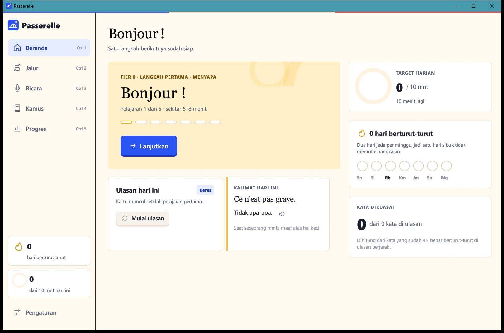
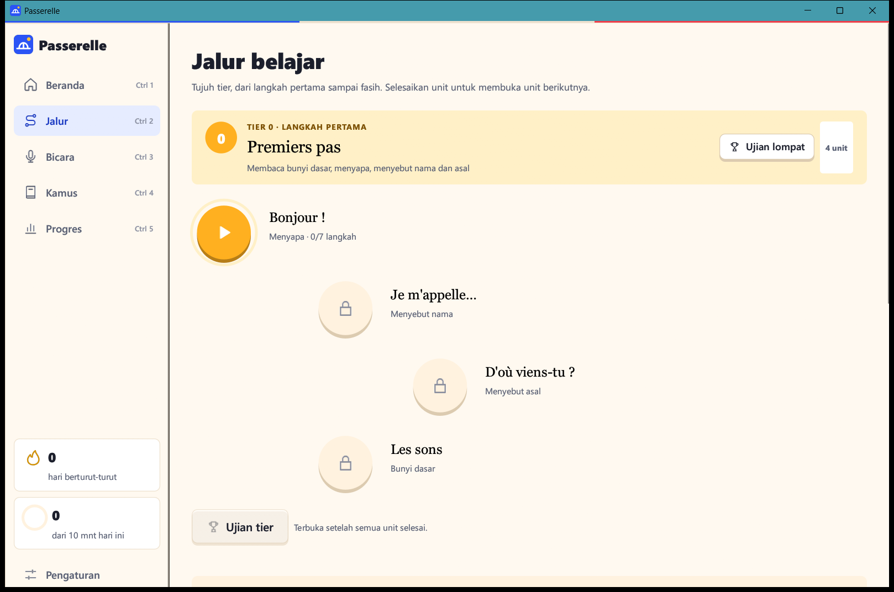
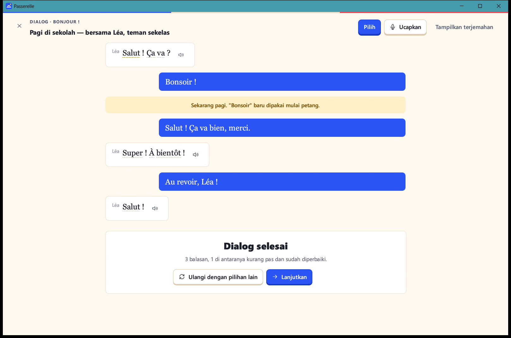
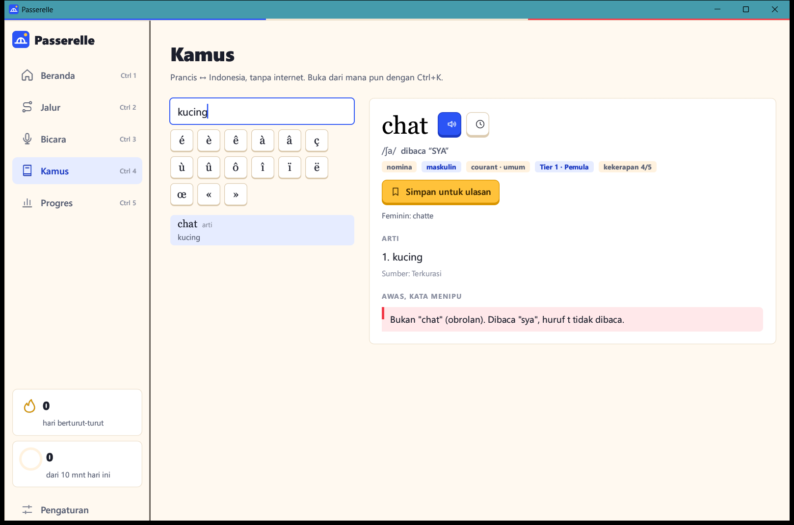

# Passerelle

Aplikasi Windows **native** untuk belajar bahasa Prancis dari nol, dibuat dengan **Rust** dan **egui**. Tidak memakai WebView, server, atau akun, dan tidak ada biaya berjalan.



## Unduh

- **[Passerelle-1.0.0-win64.zip](dist/Passerelle-1.0.0-win64.zip)** (11,5 MB), berisi:
  - `Passerelle-Setup-1.0.0.exe`: installer. Tidak butuh hak admin, dan membuat shortcut di Desktop serta Start Menu.
  - `Portable/Passerelle.exe`: langsung jalan tanpa dipasang.
- **[Dokumentasi teknis (PDF)](docs/Passerelle-Dokumentasi-Teknis.pdf)**

Installer belum ditandatangani sertifikat code signing. Jika SmartScreen muncul, pilih **Info selengkapnya → Tetap jalankan**.

## Fitur

**Jalur belajar**
- 7 tier mengikuti CEFR (Pre-A1 sampai C2). Saat ini tersedia Tier 0 lengkap dan 3 unit Tier 1.
- Setiap unit punya 5 pelajaran, dialog bercabang, dan ulasan unit.
- Naik tier lewat ujian (lulus di 80%), atau langsung coba **ujian lompat**.

**Latihan**
- 8 jenis soal: pasangkan kata, pilih arti, pilih bahasa Prancis, dengar, isi rumpang, susun kalimat, ketik dengan bilah aksen, dan ucapkan.
- Tanpa nyawa: soal yang salah muncul lagi di akhir sesi. Tombol **Kenapa?** membuka catatan tata bahasa.

**Ulasan & motivasi**
- Ulasan berjarak dengan 3 tingkat penguasaan: Dikenal, Terlatih, Dikuasai.
- Target harian, dan rangkaian hari dengan 2 hari jeda per minggu.

**Kamus**
- Kamus Prancis ↔ Indonesia: 130 entri, 629 bentuk kata, dan tabel konjugasi.
- Pencarian mengabaikan aksen dan memaafkan salah ketik ringan. Buka dari mana pun dengan **Ctrl+K**.

**Bicara**
- Rekam suara lewat mikrofon, bandingkan dengan contoh, latih pasangan bunyi, dan putar ulang riwayat rekaman.
- Contoh ucapan memakai suara Prancis bawaan Windows (WinRT).

**Progres & tampilan**
- Layar Progres: kata dikuasai, kosakata aktif, menit bicara, ketepatan per jenis kesalahan, dan tren 12 minggu.
- Tema terang dan gelap, ukuran huruf 100–150%, dan semua fungsi bisa dijalankan dengan papan ketik.

| Jalur | Dialog | Kamus |
|---|---|---|
|  |  |  |

## Build dari sumber

Butuh Rust (toolchain `x86_64-pc-windows-gnu`). Repositori ini memakai `rust-lld` dan `llvm-dlltool` bawaan Rust, jadi tidak perlu Visual Studio Build Tools maupun MinGW. Sesuaikan path di `env.ps1` dengan lokasi Rust Anda, lalu jalankan:

```powershell
. .\env.ps1
cargo build --release -p passerelle         # aplikasi -> target\release\Passerelle.exe
cargo build --release -p passerelle-setup   # installer (menanam Passerelle.exe, jadi build aplikasi dulu)
python docs\build_pdf.py                    # dokumentasi teknis (butuh reportlab)
```

## Struktur

```
app/        aplikasi (main, content, store, lesson, screens, audio, ui) + assets/content.json
installer/  installer & uninstaller Rust (HKCU, shortcut, --silent, --uninstall)
docs/       dokumentasi teknis PDF, skrip pembuatnya, tangkapan layar
dist/       paket ZIP siap pakai
```

## Privasi

Progres dan rekaman suara hanya disimpan di `%APPDATA%\Passerelle`. Aplikasi tidak melakukan koneksi jaringan.
